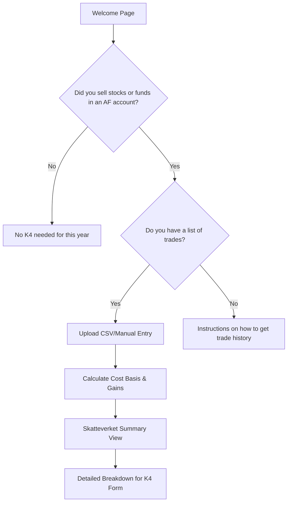

# Technical Specification: Skatteverket-style K4 Assistant

## 1. Overview
A Streamlit-based web application to assist Swedish taxpayers in calculating and filling out the K4 form for capital gains/losses on stocks and funds.

## 2. User Flow (Questionnaire)

## 3. Design System (Skatteverket Resemblance)
- **Primary Color:** #E30613 (Skatteverket Red)
- **Background:** #FFFFFF / #F5F5F5 (Light Gray)
- **Typography:** Sans-serif (Open Sans or standard system fonts)
- **Layout:** Clean, high contrast, accessible.
- **Implementation:** Custom CSS via `st.markdown("<style>...", unsafe_allow_html=True)`

## 4. Integration with `k4_assistant`
- Utilize [`src/k4_assistant/costbasis.py`](src/k4_assistant/costbasis.py) for the core calculation logic.
- Extend [`src/k4_assistant/models.py`](src/k4_assistant/models.py) to handle UI-specific inputs if needed.
- Data validation using Pydantic.

## 5. Proposed Pages
1. **Home:** Introduction and main questionnaire start.
2. **Data Entry:** CSV upload or manual form for stock sales/purchases.
3. **Calculation:** Logic execution and error handling (e.g., missing purchase data).
4. **Result:** A visual "Mirror" of the Skatteverket e-service UI showing exactly which numbers to enter in boxes 1.1, 1.2, etc.

## 6. TODO for Implementation
- [ ] Implement custom Streamlit theme/CSS.
- [ ] Build the multi-step form state management.
- [ ] Connect trade parser to calculation engine.
- [ ] Create the "Skatteverket Result Mirror" component.
