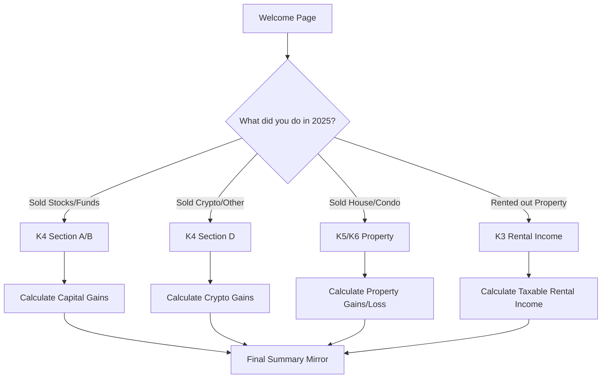

# Technical Specification: Skatteverket-style Tax Assistant

## 1. Overview
A comprehensive Streamlit-based web application to assist Swedish taxpayers in calculating and filling out various tax forms (K3, K4, K5, K6).

## 2. Multi-Form Logic Flow

## 3. Form Details & Requirements

### K4 Section D (Crypto/Other)
- **Calculation:** Average Cost Basis (Gomsomsmetoden).
- **Inputs:** Trade history (Buy/Sell/Trade/Mining/Staking).
- **Result:** Total proceeds and total cost basis for the year.

### K5/K6 (Property Sales)
- **K5:** Private housing (Småhus).
- **K6:** Condominiums (Bostadsrätt).
- **Inputs:** 
    - Sales price and selling costs (broker fees, styling).
    - Purchase price and acquisition costs (lagfart, pantbrev).
    - Improvements (Grundförbättringar & Reparationer last 5 years).
- **Logic:** Calculation of profit/loss, potential tax deferral (uppskov).

### K3 (Rental Income)
- **Inputs:** Total rental income, type of property.
- **Logic:** 
    - Automatic standard deduction (schablonavdrag: 40,000 SEK).
    - Additional deductions based on property type (20% for houses, actual fees for condos).
- **Result:** Net taxable income to be entered in the main declaration.

## 4. UI Strategy
- **Sidebar Navigation:** Switch between different sections/forms.
- **Progress Tracking:** Show which forms are "Complete".
- **Skatteverket Mirror:** Visual mimicry of the official paper/online forms for easy data entry.

## 5. Expanded Data Models
New models will be needed for `PropertySale`, `RentalIncome`, and `CryptoTrade` to handle the specific logic of each form.
